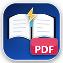

<div align="center">



# ⚡ Internet Archive PDF Downloader

**A fast, production-grade Chrome & Edge extension to stream, deobfuscate, and download complete digitized books into crystal-clear HD PDFs.**

[](https://developer.chrome.com/docs/extensions/mv3/intro/)
[](https://github.com/asfsaleh/internet-archive-pdf-downloader)
[](LICENSE)
[](https://abusaleh.pro.bd/)

[🌐 Official Website](https://abusaleh.pro.bd/pdfdownloader/) • [📥 Download Extension (.ZIP)](https://github.com/asfsaleh/internet-archive-pdf-downloader/archive/refs/heads/main.zip) • [🚀 Quick Start](#-quick-installation-1-minute) • [🌐 Supported Sites](#-supported-websites) • [⚠️ Borrowing Guide](#-crucial-how-to-download-complete-books) • [👨‍💻 Author](#-author--credits)

</div>

---

## 🌟 Overview

**Internet Archive PDF Downloader** connects directly to underlying digital library cluster servers (Internet Archive, Open Library, and BookReader instances) to stream original high-resolution scans, bypass scrambled leaf obfuscation (`AES-CTR`), and compile them directly into clean, searchable, compact PDFs with embedded metadata.

Unlike fragile screen-capture extensions, this tool:
- **Never screen-scrapes or clicks flip buttons.**
- Fetches clean JPEG/JP2 tiles directly from backend storage.
- Auto-deobfuscates protected leaves using client-side WebCrypto (`crypto.subtle`).
- Embeds raw DCT streams straight into PDF 1.4 without lossy re-encoding or browser freezing.
- Runs **100% locally in your browser** with zero external tracking.

---

## 📥 Quick Installation (1 Minute)

You don't need any complex command-line setup to use this extension!

1. **Download the Extension:**
   - Click **[Download ZIP](https://github.com/asfsaleh/internet-archive-pdf-downloader/archive/refs/heads/main.zip)** and extract the `.zip` archive to a folder on your computer.
2. **Open Extensions Page:**
   - In Google Chrome, go to: `chrome://extensions`
   - In Microsoft Edge, go to: `edge://extensions`
   - In Brave, go to: `brave://extensions`
3. **Turn on Developer Mode:**
   - Toggle the **"Developer mode"** switch located at the top-right corner.
4. **Load the Extension:**
   - Click the **"Load unpacked"** button at the top left.
   - Select the extracted `bookreader-pdf-extension` folder.
5. **Done!**
   - The **Internet Archive PDF Downloader** icon will appear in your browser toolbar.

---

## 🌐 Supported Websites

The extension operates with strict context-awareness, only activating on valid digitized book pages:

| Platform | Supported URLs | Detection Method |
| :--- | :--- | :--- |
| **Internet Archive** | `archive.org/details/{id}`<br>`archive.org/details/{id}/mode/1up`<br>`archive.org/details/{id}/mode/2up` | Native `ia-bookreader`, `_jp2.zip` cluster, `mediatype: texts` |
| **Open Library** | `openlibrary.org/books/{id}`<br>`openlibrary.org/works/{id}` | OpenLibrary embedded BookReader viewer |
| **Custom / Local BookReader** | `localhost/.../mode/1up`<br>`mytestsiteabusaleh.com/.../mode/1up` | Open-source BookReader JS/DOM instances |

> [!NOTE]
> **Zero Spam / Zero Footprint:** The extension automatically ignores Google, YouTube, social networks, and Internet Archive audio, video, movies, TV clips, and single photos. The export button **only** appears when an authentic book is open.

---

## ⚠️ CRITICAL: How to Download Complete Books

> [!IMPORTANT]
> ### 📖 Controlled Digital Lending (CDL) Requirement:
> Most modern copyrighted books on **Internet Archive** and **Open Library** are protected under digital lending rules. If you open a restricted book without logging in, the server only provides a **1-page preview**.
> 
> **To download the entire, complete book (all pages):**
> 1. Sign in to your free [archive.org](https://archive.org/account/login) account.
> 2. Open the book's details page.
> 3. Click the blue **"Borrow for 1 hour"** (or "Borrow for 14 days") button.
> 4. Once borrowed, the book reader fully unlocks and decrypts all pages in your session.
> 5. Click the **⚡ Export Book to PDF** button in the top right.
> 6. Choose your resolution (`Balanced` recommended) and click **⚡ Start Download**!
> 7. Once finished, click **"Return item"** on Archive.org when you're done reading.

---

## 💎 Features & Capabilities

### 1. 🎛️ One-Line Precision Resolution Selector
Choose the exact balance between speed, quality, and file size:
* **Low (~1200px width):** Ultra-fast stream, ideal for quick mobile reading and small storage (`~35 MB` for 500 pages).
* **Balanced (~2400px width - Recommended Default):** Super HD crystal-clear text, perfect for desktop reading and tablets (`~95 MB` for 500 pages).
* **High (~3600px width):** Lossless original archival scan quality (`~280 MB` for 500 pages).
* Dynamic file size preview calculated automatically based on selected page range.

### 2. 🔐 Native AES-CTR Decryption Engine
* Internet Archive scrambled streams send an `X-Obfuscate: 1|<iv>` header with the initial 1024 bytes encrypted.
* Employs W3C Web Cryptography API (`crypto.subtle`) using SHA-1 key derivation and AES-CTR counter blocks.
* Clean standard JPEGs decrypted on-the-fly in browser memory with zero external dependencies.

### 3. ⏹️ Cancel, Pause & Partial PDF Recovery
* Need to stop mid-download? Click **⏹️ Cancel** at any moment to abort all active network workers instantly.
* Already downloaded 200 out of 500 pages before cancelling? Click **💾 Save PDF Now** to compile and export whatever pages have been downloaded so far.

### 4. 🗜️ Direct Stream Lossless PDF Compiler
* Embeds raw JPEG DCT byte streams straight into PDF 1.4 objects without canvas re-compression.
* Preserves 100% original image sharpness while maintaining a tiny memory footprint.
* Auto-embeds book metadata (`Title`, `Author`, `Subject`, `CreationDate`).

---

## 🛠️ How to Sync Future Updates to GitHub

For developers and contributors:

```bash
# 1. Clone the repository
git clone https://github.com/asfsaleh/internet-archive-pdf-downloader.git

# 2. Make your improvements or fixes

# 3. Commit and push updates
git add .
git commit -m "feat: your enhancement description"
git push origin main
```

---

## 👨‍💻 Author & Credits

Created and maintained with precision by **Abu Saleh**:

* 🚀 **Official Webpage:** [https://abusaleh.pro.bd/pdfdownloader/](https://abusaleh.pro.bd/pdfdownloader/)
* 🌐 **Portfolio & Website:** [https://abusaleh.pro.bd/](https://abusaleh.pro.bd/)
* 🐙 **GitHub:** [@asfsaleh](https://github.com/asfsaleh)
* 📧 **Email:** [abusalehfiroz@gmail.com](mailto:abusalehfiroz@gmail.com)

---

## 📄 License

This project is licensed under the **MIT License** - see the [LICENSE](LICENSE) file for details.

*Disclaimer: This extension is intended for archival, accessibility, and educational purposes with legally borrowed or public domain materials.*
